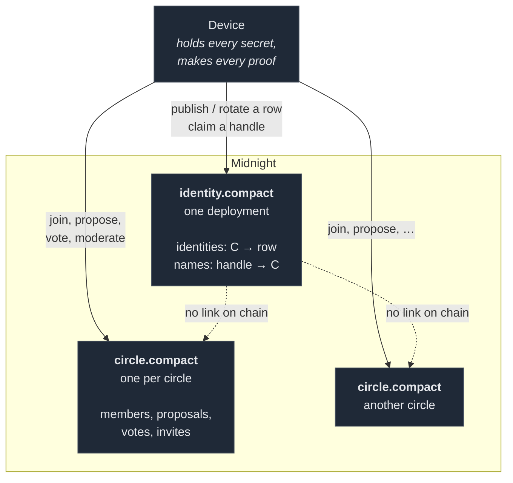
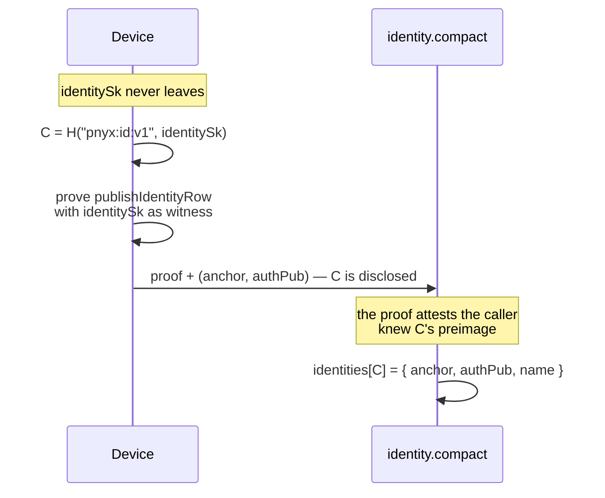
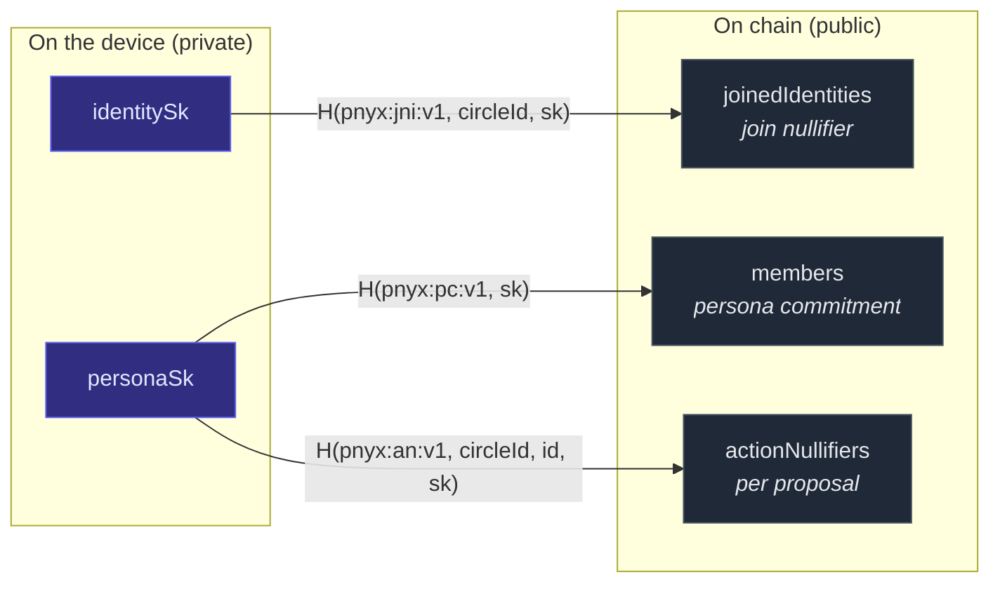
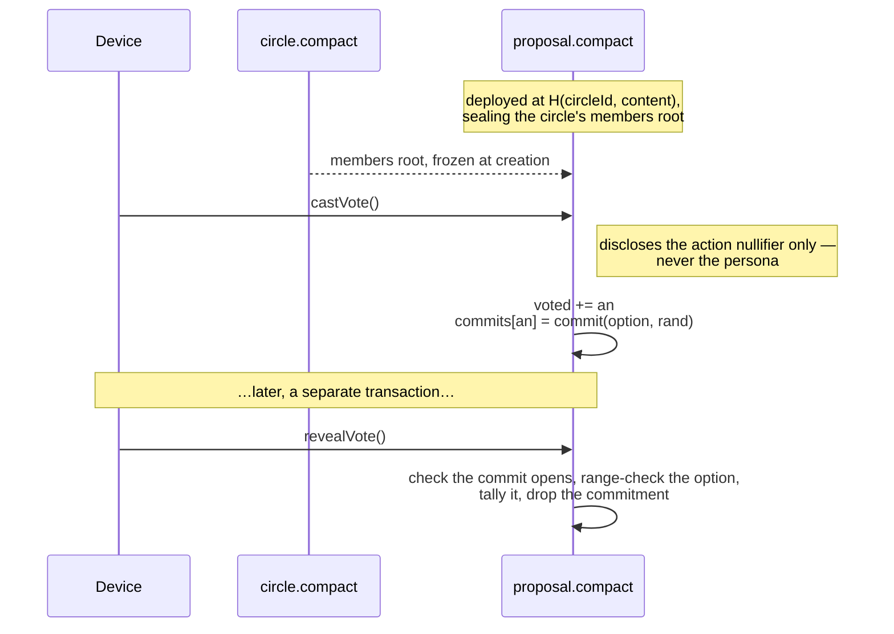
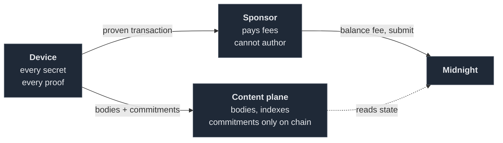

# Pnyx — the on-chain half

Pnyx is a privacy-preserving governance forum on [Midnight](https://midnight.network). People hold an
identity, join circles, propose things and vote on them — without the chain learning who voted for
what, or which circles a person belongs to.

This repository is **only the Compact contracts and the reasoning behind them**. The mobile app, the
on-device proving rail and the fee-sponsoring wallet are not here; where they matter to understanding
the on-chain design they are described, not shipped.

```
identity.compact   one deployment each     one person's row + contact card
handle.compact     one deployment each     one claimed name: owner, moderation, burn
circle.compact     one deployment each     membership, proposals, votes, moderation
```

> **⚠️ This document is mid-overhaul (2026-08-24) and the sections below still describe the previous
> topology.** `identity.compact` was a single global contract holding an `identities` map and a
> `names` map; it is now **one contract per identity**, because a contract's whole state is the unit
> of read and a registry keyed by user becomes unreadable once it has users — measured on our own
> decode path, 10,000 rows took 3.5 s and 100,000 took 766 s and 6.46 GiB, with the DM path running
> straight through it.
>
> What has changed so far: the identity contract is per-identity and carries a bounded contact card,
> and handles moved to `handle.compact` — one deployment per claimed name, where uniqueness is the
> chain's (a second claim derives the same address and is refused) rather than a map's. So every passage
> below about `names`, aliases and `claimName` describes a contract that no longer exists, and the
> 5-byte floor it mentions is retired in favour of price tiers. The design of record is
> [`docs/BOUNDED_STATE_ARCHITECTURE.md`](../docs/BOUNDED_STATE_ARCHITECTURE.md); this file still needs
> its rewrite.

## Why two contracts

A Midnight contract's state is the unit of read. There is no read-one-key query, so any lookup
downloads the whole blob, and a repeat read is only cheap while a small marker query says
"unchanged" — that marker being the contract's latest transaction.

Both contracts started as one. Sharing meant **every vote by anyone invalidated every client's
identity cache**, forcing a full re-download to read a 96-byte row that had not moved. The split is
about churn, not size: the identity contract's marker now advances only on a registration or a handle
claim.

The same argument rules out a registry of circles. A global map would grow without bound and be
downloaded whole, so there isn't one — see [Addressing](#addressing).



The dotted edges are the point: nothing on chain connects an identity to a circle it joined. The two
are related only inside a device, by two one-way functions of the same secret.

## Identity

An identity is a **commitment the contract can verify**, not an address:

```
identitySk = HKDF(seed, "pnyx:id:v1")                            // 32 bytes, never leaves the device
C          = persistentHash([pad(32, "pnyx:id:v1"), identitySk]) // the public identity
```

Every write to `C`'s row is a circuit proving knowledge of `identitySk`. **The key is the
authorisation** — there is no signature, and nothing for a reader to verify. Whoever wrote row `C`
demonstrably knew its preimage, and a caller with a different secret simply addresses a different
row. Reaching someone else's means inverting `persistentHash`.

Three consequences fall out of that, and they are the reason for the design:

- **A row can be safely overwritten.** Only its owner can write it, so rotation updates in place and
  no history accumulates.
- **There is no griefing surface.** Nobody can add junk to your row, because every other caller lands
  somewhere else.
- **It works under sponsored submission.** The proof is made on the device, so a third party can pay
  the fee without being able to author anything. This matters more than it sounds — see
  [The off-chain half](#the-off-chain-half).



The row carries three fields: `anchor`, the MLS signature key direct messages resolve to; `authPub`,
a login key a server checks a challenge against; and `name`, the primary handle.

Login follows from the row rather than from a wallet: the client sends `C` and a signature over a
server challenge, the server reads `C`'s row from chain and checks it against `authPub`. No wallet
connector is in the loop, and `authPub` can be any scheme we like because only our server verifies
it — never a circuit.

### Handles

`names` maps a handle to a `C`, many-to-one: an identity may hold aliases, and `IdentityRow.name`
says which is canonical. That split is ENSIP-7's, and it carries a UI invariant — **display always
comes from the row, never from the name that was looked up.** Echoing the query back is what would
turn an alias into an impersonation.

What the contract enforces is uniqueness of the exact bytes and a five-byte floor. Charset, script
mixing and canonical form are client-side, because they are not affordable in a circuit: touching
bytes at all costs roughly 10,800 constraint rows, and Unicode script tables are three orders of
magnitude beyond that. ENS reached the same split — ENSIP-15 is a client standard, and the registry
validates length alone.

The length rule is the one worth spending constraints on. Every other rule can be enforced
client-side because breaking it only yields a name the app refuses to draw. Short names are
different: grabbing them is precisely what a modified client would be built for.

A constructor reserves nine handles (`pnyx`, `admin`, `support`, …) by mapping them to an **all-zero
owner** that no identity can ever hold — `claimName` asserts its derived `C` is not that sentinel. So
those names are dead for everyone, us included, and neither circuit knows they are special. A
constructor runs once, so the list cannot be extended after deploy.

**Known and accepted:** a handle is a public circuit argument, so it is visible in the mempool before
finalisation and can be sniped. Commit/reveal would close that, but a Pnyx handle is not transferable
and has no resale market, so a sniped name is worth nothing to the sniper beyond griefing.

## Circles

One deployment per circle. `circleId` is sealed at deploy and folded into every derivation, which is
what keeps a circle's nullifiers distinct from every other circle's.

That matters most for the join nullifier. `identitySk` is per-network, not per-circle, so **without
`circleId` in the hash the same identity joining two circles would publish identical bytes in both**,
and an observer could link them.

### Addressing

Midnight contract addresses are content-derived — `SHA-256(initial_state, nonce)`, with no deployer
identity in the input. A client holding a `circleId` and this template computes the address offline.
There is no directory and deliberately no on-chain registry; discovery of *open* circles is an
off-chain index over public deploys.

### Membership

Members are leaves in a Merkle tree, and the only thing ever disclosed is the root. That primitive —
membership without identity — is the one every anonymity property here routes through.



Every arrow is one-way, and each uses a different domain tag. `C` and the join nullifier are
different one-way functions of the same secret, so linking them means brute-forcing 32 bytes. The
same holds between a persona's leaf and its votes: an author is disclosed, a voter never is.

**One join per identity** is what makes a ban permanent. To act you need a leaf; leaves enter only by
joining; a second persona would need a second join, and the identity nullifier is already spent. That
holds even against a modified client choosing arbitrary personas, because `personaSk`'s derivation is
a client convention while the nullifier is not.

A ban **removes the leaf**, so there is nothing left to prove membership with. Soundness comes from
rebuilding the index out of the same path that was verified — a `MerkleTreePathEntry` carries
`goes_left`, so the direction bits encode the position, and the slot cleared is provably the slot
proved. A moderator cannot aim at an arbitrary index.

Historic roots exist so an in-flight proof survives a concurrent join, and **the history is now
permanent** — the reset a ban used to call is gone, because votes left this contract. Nothing else is
harmed by a stale root: the moderator circuits check the *moderators* tree, and `leaveCircle` against a
stale root re-clears an index that is already clear. Permanence is also what makes a proposal's sealed
electorate checkable — a client can confirm the root a proposal froze is a genuine historic root of the
circle rather than a creator's tree of sock puppets.

### Voting

A ballot is secret because commit and reveal are two *transactions*. Both live in
`proposal.compact` — one deploy per proposal — so nothing about a vote is a circle write and there is no
`createProposal` circuit: the proposal's address *is* its content commitment.



`castVote` discloses the action nullifier and nothing else. Disclosing the persona there would pair
with `revealVote`'s nullifier-to-option mapping and expose persona-to-vote, destroying the secret
ballot the commitment scheme had just protected.

`revealVote` deliberately runs **no membership check**: the nullifier already proves this persona
voted while an elector, and a vote should not be voided by a later departure.

**Ballots carry more than yes/no.** `tallies: Map<Uint<8>, Uint<64>>` is seeded `0..optionCount-1` in the
constructor, and `revealVote` increments the entry at the **disclosed** index — no in-circuit branching
and no maximum frozen into every proof. Yes/no is `optionCount = 2`. Disclosing the option costs no
privacy: nullifier-to-option is public at reveal by construction, and persona-to-nullifier is what stays
hidden. ⚠️ The option is range-checked against the sealed count, because a commitment can be opened to
any `Uint<8>` and an out-of-range one would write a tally row the constructor never seeded.

**The electorate is a snapshot.** A ban after creation does not disenfranchise and a join after creation
does not enfranchise — chosen deliberately over a live electorate via `kernel.claimContractCall`, which
our toolchain does expose but which costs an entry point on each side, two proofs per vote, and a
hand-assembled two-call transaction.

## What is public and what is not

| Public on chain | Private |
|---|---|
| That identity `C` exists, and its row | The secret behind `C` |
| A handle and the `C` that owns it | — |
| A circle's existence, and whether it is open | Which identities are in it |
| Membership tree roots | Which leaf is whose, and the tree's contents by identity |
| A proposal's author persona (deliberate — a moderator must be able to name what they ban) | The link from that persona to an identity |
| That a vote happened, as a nullifier | Who cast it, and for what, until reveal |
| Tallies after reveal | The link from a voter to a ballot |
| Commitments to invites; spent-invite nullifiers | The invite secrets |

Proposal and post *bodies* are not on chain at all — the chain holds a commitment, and the content
lives off it.

## The off-chain half

Described because it shapes the contracts, not because it ships here.



**Proving happens on the device.** No server proves on a user's behalf, which is what lets the
contracts treat "a valid proof exists" as the entire authorisation story.

**Fees are sponsored, and that is safe *because* of the commitment design.** A sponsor balances and
submits a transaction it did not author and cannot alter. This is load-bearing: Midnight derives a
transaction's `caller` only from unshielded inputs, and fee payment carries no caller identity — so
any caller-based authorisation would have authenticated *the sponsor*, not the user. Proof of
knowledge sidesteps that entirely.

**The content plane never becomes authoritative.** It holds bodies and indexes; the chain holds the
commitments, the nullifiers and the tallies.

## Building

The contracts compile with the Compact toolchain (language 0.23, compiler 0.31.1):

```bash
./compile-contracts.sh          # → managed/identity, managed/circle, plus the gating numbers
```

The script prints the constraint tier (`K`) per circuit and the prover-key sizes, which is what the
design is actually bounded by.

## Measured

Compiled with compactc 0.31.1; proof latency from a local proof server, warm minimum of two runs.

| `identity.compact` — 4 entry points, 14 MB of keys | K | rows |
|---|---|---:|
| `setPrimaryName` | 13 | 4,457 |
| `publishRow` | 13 | 4,735 |
| `setRow` | 13 | 7,018 |
| `setRows` | 14 | 15,570 |

| `handle.compact` — 4 entry points, 16 MB of keys | K | rows |
|---|---|---:|
| `revoke` | 13 | 4,178 |
| `moderate` | 13 | 4,651 |
| `bind` | 14 | 8,852 |
| `rebind` | 14 | 12,276 |

`moderate` is the cheapest gate here and it holds no secret: it spends a per-name capability minted by
`payment`, because there is one of these contracts per name and a per-template secret could only ever be
rotated one transaction per name (`docs/BOUNDED_STATE_ARCHITECTURE.md` §10.5).

| `payment.compact` — 7 entry points, 49 MB of keys | K | rows |
|---|---|---:|
| `rotateAdmin` | 14 | 8,322 |
| `setPrice` | 14 | 8,665 |
| `grantPermit` | 14 | 8,840 |
| `buyPermitUnshielded` | 14 | 9,017 |
| `grantModeratePermit` | 14 | 12,945 |
| `grantRebindPermit` | 14 | 12,945 |
| `buyPermitShielded` | 16 | 33,085 |

`buyPermitShielded` alone is K16, and it is why this contract's keys are 49 MB. It exists because the
choice of *receive primitive* is frozen code where the choice of currency is mutable state — nothing
calls it yet.

| `circle.compact` — 5 entry points, 7 ledger fields, 23 MB of keys | K | rows |
|---|---|---:|
| `setInvite` | 13 | 7,112 |
| `leaveCircle` | 14 | 9,138 |
| `addModerator` | 14 | 12,163 |
| `setMember` | 14 | 14,379 |
| `join` | 14 | 14,560 |

`addModerator` went **11,885 → 12,163** on 2026-09-07 when it gained `authPub` and the
`moderatorAuth` map write — **+278 rows and no K step**, so the device downloads the same 5.2 MB
prover key. A ledger map insert is five ops and no byte casts, which is why it is nearly free; the
expensive thing in this contract remains touching bytes at all. Measured with
`zkir compile -v <circuit>.bzkir`, which prints `k` and `rows` — not inferred from the key size.

| `proposal.compact` — 2 entry points, 7.8 MB of keys | K | rows |
|---|---|---:|
| `revealVote` | 13 | 6,516 |
| `castVote` | 14 | 13,197 |

**The split made every circuit cheaper and the ballot more capable.** Proposals and votes used to live in
`circle.compact`, which had **seven** growing structures — two of them growing per *vote*, for ever, with
no compaction. A proposal is now its own deploy keyed by its content commitment
(`docs/BOUNDED_STATE_ARCHITECTURE.md` §10), so `createProposal` stopped being a circuit at all.

`join` went **K15 / 18,529 → K14 / 14,560**, a whole constraint tier, by dropping `inviteNullifier` and
the `spentInvites` write: spending an invite now *removes its commitment*, and absence enforces
single-use exactly as a nullifier did. `revealVote` went **K14 / 8,920 → K13 / 6,516** while gaining
multi-option ballots, because the vote nullifier folds a **sealed** `voteDomain` (an arity-2 hash instead
of arity 4) and the tally is a map incremented at a disclosed index rather than a branch. Circle's keys
fell from 40 MB to 23 MB, so a device downloads 17 MB less even counting proposal's 7.8 MB.

**Eleven entry points would not deploy.** A deploy carries one verifier key per entry point, and
every key is exactly 2,119 bytes whatever the circuit does — a 1,253-byte zkir produces the same key
as a 1,710-byte one. So a deploy's size is the entry-point *count* alone. Eleven made a 28,473-byte
balanced transaction that the node refuses as `Transaction would exhaust the block limits`; ten land
at 26,309.

Merging three pairs took it to eight, about 21.6 KB, with two entry points of headroom. The pairs
were invite issue/withdraw, ban/reinstate, and the open/gated join paths — in each case the merged
argument was already public, so nothing became less visible than it had been. Merging cost almost
nothing in constraints (`join` stayed at K15, using 18,529 of the 32,768 rows K15 holds — 43%
headroom), and took the prover keys from 53 MB to 40 MB, so every device downloads 13 MB less.

## Not in this repository

The on-device proving rail, the fee-sponsoring wallet, the content service and the mobile app. Also
absent: the witness implementations and domain derivations that a client must supply to call these
circuits, and the compiled `managed/` output, which is a build product.

## Licence

[Apache-2.0](LICENSE), copyright 2026 Pnyx.
